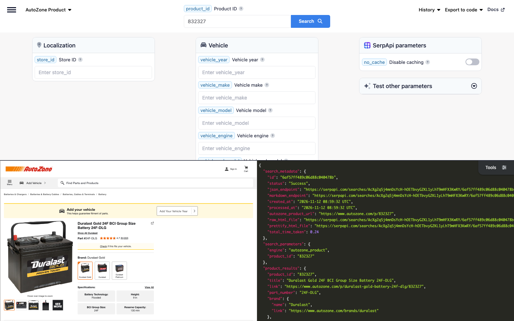

# AutoZone Product Scraper

Scrape AutoZone product pages with SerpApi's AutoZone Product API. Look up an auto part or another AutoZone product by its product ID, for a vehicle and at an AutoZone store, and get its title, part number, brand, rating, reviews, review summary, description, features, specifications, images, and videos, plus the other brands and sizes it comes in, whether it fits the vehicle, and whether it can be picked up at the store.

## How to scrape AutoZone product pages

Get the details of an AutoZone product with a simple GET request:

```text
https://serpapi.com/search?engine=autozone_product&product_id=832327&api_key=SERPAPI_API_KEY
```

- `product_id` is the AutoZone ID of the product, e.g., `832327` for the Duralast Gold 24F battery. It's the number at the end of the product's link, `https://www.autozone.com/p/duralast-gold-battery-24f-dlg/832327`, and the `sku` of the product in the [AutoZone Search API](https://serpapi.com/autozone-search-api?utm_source=github_autozone_product_scraper) results, whose `serpapi_link` leads to this API.
- `api_key` is your SerpApi API key. Replace `SERPAPI_API_KEY` with it.
- `vehicle_year`, `vehicle_make`, and `vehicle_model` set the vehicle to check the fitment of the product for, e.g., a 2015 Toyota Camry, and must be used together. Add `vehicle_engine` and `vehicle_submodel` for products that depend on them, such as batteries, and `vehicle_type` for motorcycles and recreational vehicles.
- `vehicle_token` sets the vehicle with the `vehicle_token` of an AutoZone Search API search, or of a previous response, instead of the other vehicle parameters.
- `store_id` sets the AutoZone store by its store number, shown as Store # in AutoZone's store details, e.g., `4254` for the store in Manor, Texas. `in_store_pickup` then shows whether the product can be picked up there.

The response doesn't include prices. AutoZone checks the vehicle against its catalog, so a make, model, or engine it doesn't have returns an error, e.g., "AutoZone doesn't have the `V12` engine for the 2015 Toyota Camry."

[Register at SerpApi](https://serpapi.com?utm_source=github_autozone_product_scraper) to get your API key, and keep it private.

### Playground

Try the request live in the [SerpApi Playground](https://serpapi.com/playground?engine=autozone_product&product_id=832327&utm_source=github_autozone_product_scraper).

[](https://serpapi.com/playground?engine=autozone_product&product_id=832327&utm_source=github_autozone_product_scraper)

## Code examples

The code examples read your API key from the `SERPAPI_API_KEY` environment variable:

```bash
export SERPAPI_API_KEY="SERPAPI_API_KEY"
```

Each example gets the Duralast Gold 24F battery and prints its title, part number, rating, and number of ratings, followed by the name and value of each specification.

### curl integration

Send the request with curl, which prints the full JSON response:

```bash
curl --get https://serpapi.com/search \
 --data-urlencode engine="autozone_product" \
 --data-urlencode product_id="832327" \
 --data-urlencode api_key="$SERPAPI_API_KEY"
```

### JavaScript integration

Install the [SerpApi JavaScript library](https://github.com/serpapi/serpapi-javascript) and set your project to use ES modules:

```bash
npm install serpapi
npm pkg set type=module
```

Create an `index.js` file:

```javascript
import { getJson } from "serpapi";

const results = await getJson({
  engine: "autozone_product",
  api_key: process.env.SERPAPI_API_KEY,
  product_id: "832327",
});

const product = results.product_results ?? {};
console.log(product.title, product.part_number, product.rating, product.reviews);
for (const spec of product.specifications ?? []) {
  console.log(`${spec.name}: ${spec.value}`);
}
```

Run it with `node index.js`.

### Python integration

Install the [SerpApi Python library](https://github.com/serpapi/serpapi-python):

```bash
pip install serpapi
```

Create a `main.py` file:

```python
import os
import serpapi

client = serpapi.Client(api_key=os.getenv("SERPAPI_API_KEY"))
results = client.search({
    "engine": "autozone_product",
    "product_id": "832327",
})

product = results.get("product_results", {})
print(product.get("title"), product.get("part_number"), product.get("rating"), product.get("reviews"))
for spec in product.get("specifications", []):
    print(f"{spec['name']}: {spec['value']}")
```

Run it with `python main.py`.

### Ruby integration

Install the [SerpApi Ruby library](https://github.com/serpapi/serpapi-ruby):

```bash
gem install serpapi
```

Create a `main.rb` file:

```ruby
require "serpapi"

client = SerpApi::Client.new(engine: "autozone_product", api_key: ENV.fetch("SERPAPI_API_KEY"))
results = client.search(product_id: "832327")

product = results.fetch(:product_results, {})
puts "#{product[:title]} #{product[:part_number]} #{product[:rating]} #{product[:reviews]}"
product.fetch(:specifications, []).each do |spec|
  puts "#{spec[:name]}: #{spec[:value]}"
end

client.close
```

Run it with `ruby main.rb`.

### PHP integration

Install the [SerpApi PHP library](https://github.com/serpapi/serpapi-php):

```bash
composer require serpapi/serpapi-php
```

Create an `index.php` file:

```php
<?php
require 'vendor/autoload.php';

use SerpApi\Client;

$client = new Client(getenv('SERPAPI_API_KEY'), 'autozone_product');
$results = $client->search([
  'product_id' => '832327',
]);

$product = $results->product_results ?? null;
echo ($product->title ?? '') . ' ' . ($product->part_number ?? '') . ' ' . ($product->rating ?? '') . ' ' . ($product->reviews ?? '') . PHP_EOL;
foreach ($product->specifications ?? [] as $spec) {
  echo $spec->name . ': ' . $spec->value . PHP_EOL;
}
```

Run it with `php index.php`.

### Go integration

Create a Go module and install the [SerpApi Go library](https://github.com/serpapi/serpapi-golang):

```bash
go mod init example.com/product
go get github.com/serpapi/serpapi-golang
```

Create a `main.go` file:

```go
package main

import (
	"fmt"
	"os"

	"github.com/serpapi/serpapi-golang"
)

func main() {
	setting := serpapi.NewSerpApiClientSetting(os.Getenv("SERPAPI_API_KEY"))
	setting.Engine = "autozone_product"
	client := serpapi.NewClient(setting)

	results, err := client.Search(map[string]string{
		"product_id": "832327",
	})
	if err != nil {
		panic(err)
	}

	product, _ := results["product_results"].(map[string]interface{})
	fmt.Println(product["title"], product["part_number"], product["rating"], product["reviews"])
	specifications, _ := product["specifications"].([]interface{})
	for _, item := range specifications {
		spec := item.(map[string]interface{})
		fmt.Printf("%v: %v\n", spec["name"], spec["value"])
	}
}
```

Run it with `go run .`.

### Rust integration

Create a Cargo project and add the [SerpApi Rust library](https://github.com/serpapi/serpapi-rust) and Tokio:

```bash
cargo new product && cd product
cargo add serpapi tokio --features tokio/full
```

Replace `src/main.rs` with:

```rust
use serpapi::serpapi::Client;
use std::collections::HashMap;
use std::env;

#[tokio::main]
async fn main() -> Result<(), Box<dyn std::error::Error>> {
    let mut default = HashMap::new();
    default.insert("api_key".to_string(), env::var("SERPAPI_API_KEY")?);
    default.insert("engine".to_string(), "autozone_product".to_string());
    let client = Client::new(default)?;

    let mut parameter = HashMap::new();
    parameter.insert("product_id".to_string(), "832327".to_string());

    let results = client.search(parameter).await?;
    let product = &results["product_results"];
    println!(
        "{} {} {} {}",
        product["title"].as_str().unwrap_or_default(),
        product["part_number"].as_str().unwrap_or_default(),
        product["rating"],
        product["reviews"]
    );
    if let Some(specifications) = product["specifications"].as_array() {
        for spec in specifications {
            println!(
                "{}: {}",
                spec["name"].as_str().unwrap_or_default(),
                spec["value"].as_str().unwrap_or_default()
            );
        }
    }
    Ok(())
}
```

Run it with `cargo run`.

### Other programming languages

Official libraries are also available for [Java](https://github.com/serpapi/serpapi-java), [.NET](https://github.com/serpapi/serpapi-dotnet), [Swift](https://github.com/serpapi/serpapi-swift), and [C++](https://github.com/serpapi/serpapi-cpp). See [SerpApi integrations](https://serpapi.com/integrations?utm_source=github_autozone_product_scraper) for setup guides, or use a simple GET request from any programming language.

### Errors

Failed requests return an HTTP error status and a JSON body with an `error` message. The most common are `401` for an invalid API key, `400` for a missing or invalid parameter, such as a missing `product_id`, an incomplete vehicle, or an invalid `vehicle_token`, and `429` when you exceed your hourly throughput limit or run out of searches. See [API status and error codes](https://serpapi.com/api-status-and-error-codes?utm_source=github_autozone_product_scraper) for the full list.

A request without a product still returns `200`, with `search_metadata.status` set to `Success` and an `error` message, so check for `error` before reading `product_results`. This happens for a product ID AutoZone doesn't have, with the error "AutoZone hasn't returned any results for this product.", and for a make, model, or engine AutoZone doesn't have.

## Output formats: JSON and Markdown

Choose structured JSON for applications or Markdown for LLMs and AI agents:

- JSON is the default output and is useful when you need individual result fields.
- Add `output=md` to receive Markdown instead, which is more token-efficient.

Markdown is plain text, not JSON: YAML front matter with the search metadata, followed by the vehicle when you set one, the details of the product, tables of its ratings, review mentions, options, and specifications, and lists of its features, images, videos, and categories. Read the response body as text instead of parsing it.

| Client | Markdown request |
|--------|------------------|
| curl | `--data-urlencode output="md"` |
| Python | `client.search({..., "output": "md"})` |
| PHP | `$client->md([...])` |
| Go | `client.Md(map[string]string{...})` |
| Rust | `client.md(parameter).await?` |

If your SDK doesn't have a Markdown helper yet, send a plain HTTP request with `output=md` and read the body as text. Learn more about [Markdown output](https://serpapi.com/markdown-output?utm_source=github_autozone_product_scraper).

## AutoZone Product API parameters

See the [AutoZone Product API documentation](https://serpapi.com/autozone-product-api?utm_source=github_autozone_product_scraper) for more details.

| Name | Description | Requirement |
|------|-------------|-------------|
| **Search query** | | |
| `product_id` | The AutoZone ID of the product (e.g., `832327`). It's the number at the end of the product's link on AutoZone (e.g., `https://www.autozone.com/p/duralast-gold-battery-24f-dlg/832327`), and the `sku` of the product in the AutoZone Search API results. | Required |
| **Localization** | | |
| `store_id` | The AutoZone store to check in-store pickup at, as its store number, shown as Store # in AutoZone's store details (e.g., `4254` for the store in Manor, Texas). Adds `in_store_pickup` to the response. An unknown store number doesn't return an error, but the product can't be picked up there. | Optional |
| **Vehicle** | | |
| `vehicle_year` | The year of the vehicle to check the fitment of the product for (e.g., `2015`). Requires `vehicle_make` and `vehicle_model`. | Optional |
| `vehicle_make` | The make of the vehicle, as named on AutoZone (e.g., `Toyota`). Requires `vehicle_year` and `vehicle_model`. | Optional |
| `vehicle_model` | The model of the vehicle, as named on AutoZone (e.g., `Camry`). Requires `vehicle_year` and `vehicle_make`. | Optional |
| `vehicle_engine` | The engine of the vehicle, as named on AutoZone (e.g., `4 Cylinders 2.5L GAS`). Requires `vehicle_year`, `vehicle_make`, and `vehicle_model`. | Optional |
| `vehicle_submodel` | The submodel of the vehicle, as named on AutoZone (e.g., `LE`). Without it, products that only fit some submodels have `fitment` set to `needs_more_info`. Requires `vehicle_year`, `vehicle_make`, and `vehicle_model`. | Optional |
| `vehicle_type` | The type of the vehicle: `car_truck` for Car & Truck (default), `motorcycle` for Motorcycle, or `recreational` for Recreational (e.g., `motorcycle` with `2015`, `Harley-Davidson`, and `FLD Switchback`). Requires `vehicle_year`, `vehicle_make`, and `vehicle_model`. | Optional |
| `vehicle_token` | The vehicle, as the `search_information.vehicle.vehicle_token` of an AutoZone Search API search or of a previous response, so AutoZone doesn't have to look the vehicle up again. It's also in the `serpapi_link` of the AutoZone Search API results for a vehicle. Can't be used with the other vehicle parameters. | Optional |
| **SerpApi parameters** | | |
| `engine` | Set to `autozone_product`. | Required |
| `api_key` | Your private SerpApi API key. | Required |
| `no_cache` | Set to `true` to request fresh results instead of using the one-hour cache. Can't be combined with `async`. | Optional |
| `async` | Set to `true` for later retrieval through the [Searches Archive API](https://serpapi.com/search-archive-api?utm_source=github_autozone_product_scraper). Can't be combined with `no_cache` or used with Ludicrous Speed enabled. | Optional |
| `zero_trace` | Enterprise only. Set to `true` to skip storing search parameters, files, and metadata on SerpApi servers. | Optional |
| `output` | Set to `json` (default), `html` for the raw JSON retrieved from AutoZone, or `md` for Markdown. | Optional |
| `json_restrictor` | Limit the JSON response to the fields you need. See the [JSON Restrictor](https://serpapi.com/json-restrictor?utm_source=github_autozone_product_scraper) documentation. | Optional |

## Available data on AutoZone product pages (JSON response)

`product_results` describes the product, and with a vehicle, `search_information.vehicle` describes the vehicle. The field guides below describe the possible fields and their types; they aren't literal API responses.

### What you get depends on the product and vehicle

Some fields appear only when AutoZone shows them, or when you set a store or vehicle:

| Product | Fields |
|---------|--------|
| Any product, with `store_id` | `in_store_pickup` with whether the product can be picked up at the store |
| Any product, with a vehicle | `search_information.vehicle` with the vehicle as AutoZone names it and its `vehicle_token`, and `fitment` for the vehicle instead of `needs_base_vehicle` |
| A part with fitment details for the vehicle | `location` of the part on the vehicle, e.g., Front, and fitment `notes`, e.g., OEM exact fit |
| A product with ratings | `rating`, `reviews` with the number of ratings, and `ratings` with the share of each number of stars |
| A product with written reviews | `written_reviews` and `recommended_percentage`, plus `reviews_summary` and `review_mentions` when there are enough reviews |
| A product that comes in other brands, sizes, or locations on the vehicle | `variants` with the options and the product for each |
| A product with a safety data sheet, e.g., a battery or motor oil | `safety_data_sheet` |
| A product with videos | `videos` |

`fitment` is `needs_base_vehicle` for vehicle-specific products when you don't set a vehicle. For a vehicle, it's `fits`, `does_not_fit`, or `needs_more_info` when the product depends on the engine or submodel of the vehicle, e.g., for batteries. Set `vehicle_engine` and `vehicle_submodel` to resolve it. Universal products have `vehicle_specific` set to `false` and `fitment` set to `fits`, or `may_not_fit` for products such as universal floor mats, with or without a vehicle.

Most products have a `description`, `features`, and `specifications`, but some, such as car wash soaps, only have images and reviews. The response doesn't include prices.

### Product details

`product_results` describes the product:

```json
{
  "product_results": {
    "product_id": "String - AutoZone ID of the product, e.g., 832327",
    "title": "String - Title of the product, e.g., Duralast Gold 24F BCI Group Size Battery 24F-DLG",
    "link": "String - Link to the product on AutoZone",
    "part_number": "String - Part number of the product, e.g., 24F-DLG",
    "brand": {
      "name": "String - Brand of the product, e.g., Duralast",
      "link": "String - Link to the brand page on AutoZone"
    },
    "rating": "Float - Average rating out of 5, e.g., 4.7",
    "reviews": "Integer - Number of ratings, e.g., 8033",
    "written_reviews": "Integer - Number of reviews with a text, e.g., 5269",
    "ratings": [
      {
        "stars": "Integer - Number of stars, from 5 to 1",
        "percentage": "Integer - Share of the ratings with this number of stars, in percent, e.g., 85"
      }
    ],
    "recommended_percentage": "Integer - Share of the reviewers who recommend the product, in percent, e.g., 94",
    "reviews_summary": "String - Summary of the reviews, generated by AutoZone",
    "review_mentions": [
      {
        "name": "String - Topic mentioned in the reviews, e.g., price",
        "reviews": "Integer - Number of reviews that mention the topic, e.g., 464"
      }
    ],
    "in_store_pickup": "Boolean - Whether the product can be picked up at the store, only with store_id",
    "vehicle_specific": "Boolean - Whether the product fits only some vehicles, false for universal products",
    "fitment": "String - Whether the product fits the vehicle: fits, may_not_fit, does_not_fit, needs_more_info, or needs_base_vehicle without a vehicle",
    "location": "String - Location of the part on the vehicle, e.g., Front",
    "notes": "Array[String] - Fitment notes for the vehicle, e.g., OEM exact fit",
    "description": "String - Description of the product",
    "features": "Array[String] - Features of the product, e.g., Impact resistant construction minimizes damage from vibration",
    "specifications": [
      {
        "name": "String - Name of the specification, e.g., CCA",
        "value": "String - Value of the specification, e.g., 750 A"
      }
    ],
    "safety_data_sheet": "String - Link to the safety data sheet of the product, a PDF",
    "images": "Array[String] - Links to the images of the product",
    "videos": [
      {
        "title": "String - Title of the video, e.g., What Sets Duralast Gold Batteries Apart?",
        "link": "String - Link to the video file"
      }
    ],
    "categories": [
      {
        "name": "String - Name of the category, e.g., Batteries & Chargers",
        "link": "String - Link to the category page on AutoZone"
      }
    ]
  }
}
```

### Options

`variants` lists the options AutoZone shows for the product, e.g., Brand, Container Size, or Location, with the product for each value:

```json
{
  "product_results": {
    "variants": [
      {
        "title": "String - Name of the option, e.g., Brand, Container Size, or SAE Oil Weight",
        "items": [
          {
            "name": "String - Value of the option, e.g., Duralast Platinum",
            "selected": "Boolean - Whether it's the value of this product",
            "product_id": "String - AutoZone ID of the product with this value and the other selected values, e.g., 1070521",
            "link": "String - Link to that product on AutoZone",
            "serpapi_link": "String - SerpApi link to the details of that product with this API, for the same store and vehicle",
            "thumbnail": "String - Link to the image of that product"
          }
        ]
      }
    ]
  }
}
```

A value that isn't available with the other selected values, e.g., 6 gal for 0W-20 motor oil, has no `product_id`, `link`, or `serpapi_link`. Some options, such as Location and SAE Oil Weight, have no `thumbnail`. With a vehicle, `variants` only has the values for the vehicle, e.g., without the Duralast Severe Duty brake pads for a 2015 Toyota Camry, and each `serpapi_link` keeps the vehicle with its `vehicle_token`.

### Vehicle

With a vehicle, `search_information.vehicle` has the vehicle as AutoZone names it:

```json
{
  "search_information": {
    "vehicle": {
      "year": "Integer - Year of the vehicle, e.g., 2015",
      "make": "String - Make of the vehicle, as named on AutoZone, e.g., Toyota",
      "model": "String - Model of the vehicle, as named on AutoZone, e.g., Camry",
      "engine": "String - Engine of the vehicle, as named on AutoZone, if set, e.g., 4 Cylinders 2.5L GAS",
      "submodel": "String - Submodel of the vehicle, as named on AutoZone, if set, e.g., LE",
      "vehicle_token": "String - Token of the vehicle, for the vehicle_token parameter"
    }
  }
}
```

Pass `vehicle_token` to check more products for the same vehicle without looking it up again. Tokens from the AutoZone Search API work the same way.

## AI agents and no-code

### MCP

Give AI agents and assistants an AutoZone product details tool with the hosted [SerpApi MCP server](https://github.com/serpapi/serpapi-mcp) at `https://mcp.serpapi.com/mcp`.

Claude Code:

```bash
claude mcp add --transport http serpapi https://mcp.serpapi.com/mcp --header "Authorization: Bearer $SERPAPI_API_KEY"
```

Codex, which reads the key from `SERPAPI_API_KEY`:

```bash
codex mcp add serpapi --url https://mcp.serpapi.com/mcp --bearer-token-env-var SERPAPI_API_KEY
```

Other MCP clients:

```json
{
  "mcpServers": {
    "serpapi": {
      "type": "http",
      "url": "https://mcp.serpapi.com/SERPAPI_API_KEY/mcp"
    }
  }
}
```

The server's engine catalog includes the `autozone_product` engine, and its `serpapi://engines/autozone_product` resource describes the parameters. Ask your agent to get the details of an AutoZone product, or to check whether it fits a vehicle, with the `autozone_product` engine. The resulting tool call looks like this:

```json
{
  "name": "search",
  "arguments": {
    "params": {
      "engine": "autozone_product",
      "product_id": "832327"
    }
  }
}
```

See the [MCP integration guide](https://serpapi.com/integrations/mcp?utm_source=github_autozone_product_scraper) for more clients and self-hosting.

### CLI

Get AutoZone product details from your terminal or from AI agent workflows with the [SerpApi CLI](https://github.com/serpapi/serpapi-cli):

```bash
brew tap serpapi/homebrew-tap
brew install serpapi-cli
```

The CLI picks up `SERPAPI_API_KEY` from your environment. You can also run `serpapi login` to save a key.

```bash
serpapi search engine=autozone_product product_id=832327
serpapi search engine=autozone_product product_id=832327 --fields "product_results.{title, part_number, rating, reviews}"
serpapi search engine=autozone_product product_id=832327 output=md
```

### No-code tools

Use SerpApi APIs without writing code:

- [NoCodeSerpApi](https://nocodeserpapi.com/)
- [SerpApi with n8n](https://serpapi.com/blog/tag/n8n/)
- [SerpApi with Make](https://serpapi.com/blog/tag/make/)
- [More integrations](https://github.com/serpapi/serpapi-integrations/)

## Use cases

- Check whether a part fits a customer's vehicle before they buy it, with its location on the vehicle and fitment notes.
- Check that your brand's products show the right part number, specifications, and safety data sheet on AutoZone.
- Monitor the ratings, review summaries, and review topics of your products and competing brands on AutoZone.
- Compare the brands and sizes a part comes in, e.g., Duralast, Duralast Gold, and Duralast Platinum batteries.
- Enrich AutoZone Search API results with full product details for the same vehicle and store.
- Give AI agents, RAG pipelines, and car maintenance assistants a tool to look up auto parts and their fitment.

## Related scrapers

- [AutoZone Scraper](https://github.com/serpapi/autozone-scraper): AutoZone search results, with the product IDs and vehicle tokens for this API
- [NAPA Scraper](https://github.com/serpapi/napa-scraper): NAPA Auto Parts search results
- [Amazon Product Scraper](https://github.com/serpapi/amazon-product-scraper): product pages by ASIN
- [Google Shopping Scraper](https://github.com/serpapi/google-shopping-scraper): products and prices from Google Shopping

## Contact

Feel free to reach out at [contact@serpapi.com](mailto:contact@serpapi.com).
